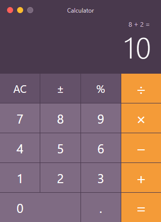

<div align="center">


<p>A compact, macOS-inspired calculator for your desktop.<br>Plum tones, warm orange keys, and the shortcuts your fingers already know.</p>

<p>
  
  
  
  <a href="LICENSE"></a>
</p>

<p>
  <a href="#quick-start">Quick start</a> &nbsp;·&nbsp;
  <a href="#a-closer-look">Features</a> &nbsp;·&nbsp;
  <a href="#keyboard-first">Shortcuts</a> &nbsp;·&nbsp;
  <a href="#under-the-hood">Development</a>
</p>

<br>



<p><sub>The actual app. A focused 320 × 440 window for everyday calculations.</sub></p>

</div>

## A closer look

| A familiar feel | Fast by keyboard | Thoughtful details |
| :--- | :--- | :--- |
| A macOS-inspired layout with a plum and orange palette. | Numbers, operators, percentages, and shortcuts at your fingertips. | Operation previews, selected operator feedback, and text that adapts to long results. |

- **Everyday arithmetic.** Four operations, decimals, negative values, percentages, and repeated equals.
- **Room to recover.** Backspace edits your input; a new number clears division-by-zero or overflow errors.
- **Accessible controls.** Real buttons, visible keyboard focus, and a live result announcement.
- **A small desktop companion.** Drag the title bar, minimize with yellow, close with red.
- **Local calculations.** No runtime network requests; the renderer is sandboxed and isolated from Node.js.

## Quick start

You need **Node.js 22.12+**, npm, and a graphical desktop. Open a terminal in the project folder:

```sh
npm ci
npm start
```

**Platform status:** tested on Windows. macOS and Linux have not been verified. This repository contains source code; prebuilt installers are not included.

## Keyboard first

Click a key, or keep your hands on the keyboard.

| Key | Action |
| :--- | :--- |
| <kbd>0</kbd>–<kbd>9</kbd> | Enter digits |
| <kbd>.</kbd> or <kbd>,</kbd> | Decimal separator |
| <kbd>+</kbd> <kbd>-</kbd> <kbd>*</kbd> <kbd>/</kbd> | Add, subtract, multiply, divide |
| <kbd>Enter</kbd> or <kbd>=</kbd> | Calculate; press again to repeat |
| <kbd>%</kbd> | Percentage |
| <kbd>F9</kbd> | Change sign |
| <kbd>Backspace</kbd> | Delete the last input digit |
| <kbd>Esc</kbd> / <kbd>Delete</kbd> / <kbd>C</kbd> | Clear all |
| <kbd>Tab</kbd>, then <kbd>Space</kbd> | Navigate and activate buttons |

<details>
<summary><strong>How percentages and chained operations work</strong></summary>

Operations evaluate **sequentially**, like a basic desktop calculator.

| Try this | Result | What happens |
| :--- | ---: | :--- |
| `2 + 3 * 4 =` | `20` | Calculate 2 + 3, then multiply by 4 |
| `200 + 10 % =` | `220` | Add 10% of 200 |
| `200 * 10 % =` | `20` | Multiply 200 by 0.1 |
| `2 + 3 = =` | `8` | Repeat the last addition |
| `0.1 + 0.2 =` | `0.3` | Display a rounded decimal result |

Input is limited to **12 digits**. Results use **12 significant digits**, with scientific notation when needed. Enter a new number or clear to recover from an error.

</details>

## Under the hood

A small codebase with calculation logic kept separate from the interface.

```text
mac-calculator/
├── index.js                 Electron window and lifecycle
├── preload.js               Limited close/minimize bridge
├── calculator.js            Calculation logic
├── renderer.js              Display, buttons, and keyboard input
├── index.html               Accessible interface
├── style.css                Plum and orange theme
├── tests/
│   ├── calculator.test.js   Calculation and state regression tests
│   └── ui.cjs               Actual Electron interface checks
└── .github/workflows/
    └── ci.yml               Automated Windows checks
```

### Run the checks

```sh
npm run check       # JavaScript syntax
npm test            # Calculation and state tests
npm run test:ui     # Electron interaction and layout tests
```

The UI test briefly opens the app, checks keyboard and mouse input, error recovery, layout, and window controls, then closes it. A screenshot is saved to `artifacts/calculator.png`.

**GitHub Actions** runs these checks on Windows for pushes and pull requests. **Dependabot** checks npm packages and GitHub Actions monthly.

<details>
<summary><strong>Troubleshooting: Electron starts as Node.js</strong></summary>

If Electron runs as Node.js instead of opening a window, remove the `ELECTRON_RUN_AS_NODE` environment variable. In PowerShell:

```powershell
Remove-Item Env:ELECTRON_RUN_AS_NODE -ErrorAction SilentlyContinue
npm start
```

</details>

## Make it better

Found a bug or have an improvement in mind? See [CONTRIBUTING.md](CONTRIBUTING.md) for setup, conventions, and what to include in a bug report.

---

<div align="center">

**Mac Calculator** · Built with Electron and vanilla JavaScript.<br>
<sub>Available under the <a href="LICENSE">ISC license</a>. The gray window indicator is decorative; resizing is disabled.</sub>

</div>
